

<a href="https://cristianramirez.up.railway.app">
  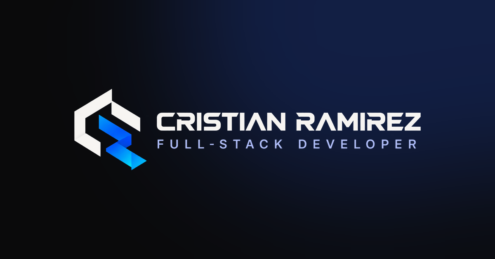
</a>

 

  

I design and build web products from understanding the problem to delivering a functional solution — 
**requirements, architecture, data, backend, frontend and user experience**.

My primary stack is **Django + Angular**, but I work from solid fundamentals 
that let me adapt to different technologies and product needs.

 

<picture>
  <source media="(prefers-color-scheme: dark)" srcset="./assets/hero-dark.svg"/>
  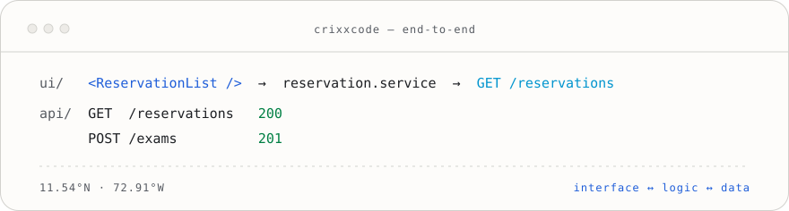 → reservation.service → GET /reservations · api/ GET /reservations 200 · POST /exams 201 · interface ↔ logic ↔ data"/>
</picture>

  

<!-- ───────────────────────────── 01 ───────────────────────────── -->

<picture>
  <source media="(prefers-color-scheme: dark)" srcset="./assets/header-01-dark.svg"/>
  
</picture>

 

<code>01 / SaaS · Hospitality Tech · Full-Stack</code>

<h3>Wayra Travel</h3>

<b>Multitenant SaaS for centralizing and managing lodging operations from a single platform.</b>

<a href="https://wayra-travel.com/">
  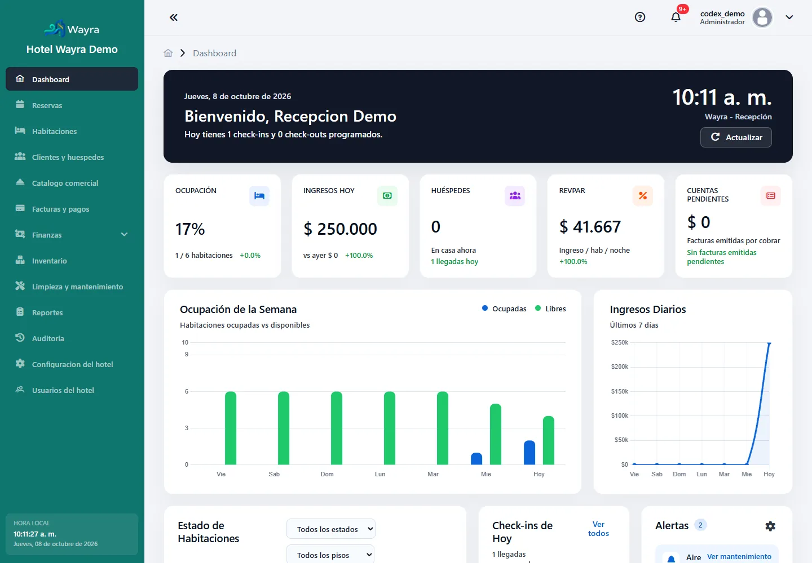
</a>

  

  

<table>
  <tr><td><code>ORIGIN</code></td><td>Originally developed from an academic project and later evolved into a SaaS product.</td></tr>
  <tr><td><code>PROBLEM</code></td><td>Many properties manage bookings, guests, rooms, payments, inventory and other processes with information scattered across spreadsheets, paper records and disconnected tools, which makes data hard to keep consistent, trace and look up.</td></tr>
  <tr><td><code>MY&nbsp;CONTRIBUTION</code></td><td>Built jointly as part of a two-developer team, contributing across requirements gathering, architecture, data modeling, backend, frontend, authentication and authorization, multitenancy, user experience, testing, documentation and deployment.</td></tr>
  <tr><td><code>KEY&nbsp;FEATURES</code></td><td>Bookings &amp; availability · Guests &amp; rooms · Billing, payments &amp; charges · Services, packages &amp; promotions · Inventory &amp; expenses · Reports &amp; operational control · Per-property settings &amp; branding · Notifications</td></tr>
  <tr><td><code>TECHNICAL&nbsp;DECISION</code></td><td><b><i>Multitenant isolation</i></b> — the platform separates data by property to prevent information from crossing organizational boundaries, complementing this isolation with role- and resource-based access control.</td></tr>
  <tr><td><code>APPLIED&nbsp;CONCEPTS</code></td><td><code>REST</code> <code>RBAC</code> <code>Multitenancy</code> <code>Relational design</code></td></tr>
</table>

   

<code>02 / EdTech · Universidad de La Guajira · Full-Stack</code>

<h3>Ejercitador Saber Pro</h3>

<b>Institutional platform focused on preparing, training and assessing the generic competencies evaluated in Colombia's Saber Pro exams.</b>

  

  

<table>
  <tr><td><code>CONTEXT</code></td><td>Project led by the Vice-Rector's Office for Teaching at Universidad de La Guajira to strengthen the generic competencies assessed in the Saber Pro exams.</td></tr>
  <tr><td><code>MY&nbsp;ROLE</code></td><td>Junior Full-Stack Developer · Independent contractor</td></tr>
  <tr><td><code>MY&nbsp;CONTRIBUTION</code></td><td>I joined the project during an existing development stage. My work has focused on functional and technical QA, cross-module testing, bug detection and correction, reviewing system behavior, and refactoring architectural components to support the platform's continued evolution.</td></tr>
  <tr><td><code>KEY&nbsp;FEATURES</code></td><td>Practice &amp; diagnostics · Competency-based training · Mock exams · Gamification · AI integration · Feedback &amp; analytics · Question bank management</td></tr>
  <tr><td><code>TECHNICAL&nbsp;WORK</code></td><td><code>QA</code> <code>Functional Testing</code> <code>Refactoring</code> <code>Bug Fixing</code></td></tr>
</table>

<i>The Ejercitador Saber Pro repository is private, so it has no public link.</i>

  

<!-- ───────────────────────────── 02 ───────────────────────────── -->

<picture>
  <source media="(prefers-color-scheme: dark)" srcset="./assets/header-02-dark.svg"/>
  
</picture>

 

<code>June 2026 – Present · Current</code>

<h3>ALGORITHM S.A.S.</h3>

<b>Junior Full-Stack Developer · Independent contractor</b>

I contribute to the development and evolution of web applications for company clients, 
working on backend development with **ASP.NET Core/.NET** and frontend development with **React**. 
My work has included QA and stabilization of existing solutions, as well as taking part in the 
full development cycle of a new application that is currently in its testing phase.

**Client project** — multitenant web application for searching and booking accommodation.

<table>
  <tr><td><code>01</code>&nbsp; Building and maintaining backend features with ASP.NET Core/.NET.</td><td><code>05</code>&nbsp; Gathering, analyzing and refining requirements.</td></tr>
  <tr><td><code>02</code>&nbsp; Building frontend interfaces and flows with React.</td><td><code>06</code>&nbsp; Designing interfaces and supporting user experience decisions.</td></tr>
  <tr><td><code>03</code>&nbsp; Designing and consuming REST APIs.</td><td><code>07</code>&nbsp; Running functional QA and cross-module testing.</td></tr>
  <tr><td><code>04</code>&nbsp; Integrating third-party services and APIs.</td><td><code>08</code>&nbsp; Detecting, analyzing and fixing bugs.</td></tr>
</table>

<i>Client names, source code and internal project details remain confidential.</i>

  

<code>September 2026 – Present · Current</code>

<h3>Universidad de La Guajira</h3>

<b>Junior Full-Stack Developer · Independent contractor</b>

Working with the Vice-Rector's Office for Teaching at Universidad de La Guajira to support 
the development and technical evolution of the **Ejercitador Saber Pro** platform. 
I work as a full-stack developer on an existing codebase, focusing on QA, testing, bug fixing and refactoring.

<table>
  <tr><td><code>01</code>&nbsp; Functional and technical QA of the system.</td><td><code>04</code>&nbsp; Reviewing existing flows and validating behavior.</td></tr>
  <tr><td><code>02</code>&nbsp; Running cross-module tests.</td><td><code>05</code>&nbsp; Refactoring components of the existing architecture.</td></tr>
  <tr><td><code>03</code>&nbsp; Detecting, documenting and fixing bugs.</td><td><code>06</code>&nbsp; Supporting the product's technical and functional evolution.</td></tr>
</table>

  

<!-- ───────────────────────────── 03 ───────────────────────────── -->

<picture>
  <source media="(prefers-color-scheme: dark)" srcset="./assets/header-03-dark.svg"/>
  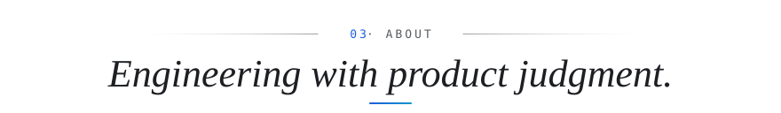
</picture>

 

I like getting involved in a product before the first line of code is written. 
Understanding the problem, gathering requirements, designing the solution, and making decisions 
about architecture, data and interfaces are all part of how I approach development.

I work across both frontend and backend, and I especially enjoy problems that connect the two: 
**architecture, APIs, data models and coherent user experiences**.

**Django + Angular** is my primary stack, but I don't define my work by a framework. 
I focus on building solid fundamentals that transfer across technologies 
while continuing to grow toward **software architecture**.

<h3><i>"Tools change. The ability to build solutions doesn't."</i></h3>

 

<picture>
  <source media="(prefers-color-scheme: dark)" srcset="./assets/highlights-dark.svg"/>
  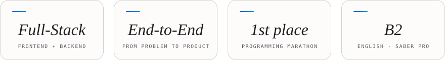
</picture>

  

<!-- ───────────────────────────── 04 ───────────────────────────── -->

<picture>
  <source media="(prefers-color-scheme: dark)" srcset="./assets/header-04-dark.svg"/>
  
</picture>

 <code>PRIMARY STACK</code>

 <code>PROFESSIONAL USE</code>

 <code>HANDS-ON EXPERIENCE</code>

 <code>TOOLS</code>

 <code>TRANSFERABLE FUNDAMENTALS</code>

I work from fundamentals that stay consistent across technologies: 
**HTTP, APIs, relational data modeling, components, state, authentication, authorization and separation of concerns**. 
That lets me move between different stacks without depending exclusively on a single framework.

 <code>APPLIED CONCEPTS</code>

  

<!-- ───────────────────────────── 05 ───────────────────────────── -->

<picture>
  <source media="(prefers-color-scheme: dark)" srcset="./assets/header-05-dark.svg"/>
  
</picture>

 

| Period | Program | Institution | Status |
|:---:|:---:|:---:|:---:|
| <code>2022&nbsp;–&nbsp;Present</code> | **Systems Engineering** | Universidad de La Guajira | Tenth semester · Expected graduation: first half of 2027 |
| <code>2020&nbsp;–&nbsp;2021</code> | **Systems Technician** | SENA | Completed |

 <code>INTERESTS</code>

 <code>ACHIEVEMENTS</code>

<picture>
  <source media="(prefers-color-scheme: dark)" srcset="./assets/achievements-dark.svg"/>
  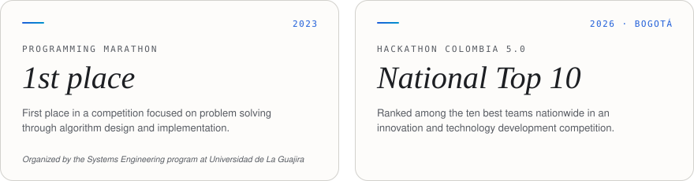
</picture>

 

 <code>SABER PRO</code>

<picture>
  <source media="(prefers-color-scheme: dark)" srcset="./assets/saber-pro-dark.svg"/>
  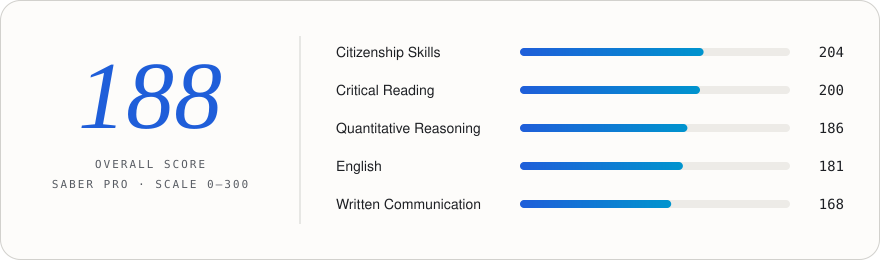
</picture>

  

<!-- ───────────────────────────── 06 ───────────────────────────── -->

<picture>
  <source media="(prefers-color-scheme: dark)" srcset="./assets/header-06-dark.svg"/>
  
</picture>

 

I keep public repositories for personal projects, academic work and technical exercises 
that document part of my work and growth as a developer.

 

<a href="https://github.com/CrixxCode/wayra-gh"><picture>
  <source media="(prefers-color-scheme: dark)" srcset="./assets/repo-wayra-dark.svg"/>
  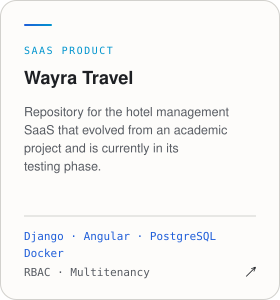
</picture></a>
<a href="https://github.com/CrixxCode/ProyectoLabClinico"><picture>
  <source media="(prefers-color-scheme: dark)" srcset="./assets/repo-labclinico-dark.svg"/>
  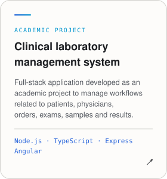
</picture></a>
<a href="https://github.com/CrixxCode/prueba-fullstack-jr"><picture>
  <source media="(prefers-color-scheme: dark)" srcset="./assets/repo-dotnet-dark.svg"/>
  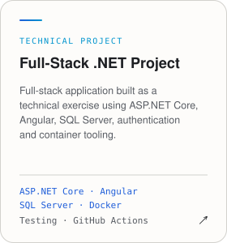
</picture></a>

  

<picture>
  <source media="(prefers-color-scheme: dark)" srcset="https://github-stats-extended.vercel.app/api?username=CrixxCode&show_icons=true&hide_border=true&border_radius=16&bg_color=111213&title_color=528DFF&icon_color=2BBDF5&text_color=F3F0EA"/>
  
</picture>
<picture>
  <source media="(prefers-color-scheme: dark)" srcset="https://github-stats-extended.vercel.app/api/top-langs/?username=CrixxCode&layout=compact&hide_border=true&border_radius=16&bg_color=111213&title_color=528DFF&text_color=F3F0EA"/>
  
</picture>

<picture>
  <source media="(prefers-color-scheme: dark)" srcset="https://github-readme-streak-stats.herokuapp.com/?user=CrixxCode&hide_border=true&border_radius=16&background=111213&stroke=17181B&ring=528DFF&fire=2BBDF5&currStreakLabel=F3F0EA&sideLabels=F3F0EA&currStreakNum=F3F0EA&sideNums=F3F0EA&dates=9A9FA6"/>
  
</picture>

  

<!-- ───────────────────────────── 07 ───────────────────────────── -->

<picture>
  <source media="(prefers-color-scheme: dark)" srcset="./assets/header-07-dark.svg"/>
  
</picture>

 

<picture>
  <source media="(prefers-color-scheme: dark)" srcset="./assets/service-fullstack-dark.svg"/>
  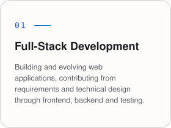
</picture>
<picture>
  <source media="(prefers-color-scheme: dark)" srcset="./assets/service-analysis-dark.svg"/>
  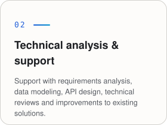
</picture>
<picture>
  <source media="(prefers-color-scheme: dark)" srcset="./assets/service-product-dark.svg"/>
  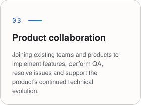
</picture>

  

<!-- ───────────────────────────── 08 ───────────────────────────── -->

<picture>
  <source media="(prefers-color-scheme: dark)" srcset="./assets/header-08-dark.svg"/>
  
</picture>

 

I'm available for projects, collaborations and opportunities where I can contribute 
as a Full-Stack Developer while continuing to grow as a software engineer.

 

  

● Available for remote work

  

<i>Designed and built with intent.</i>

